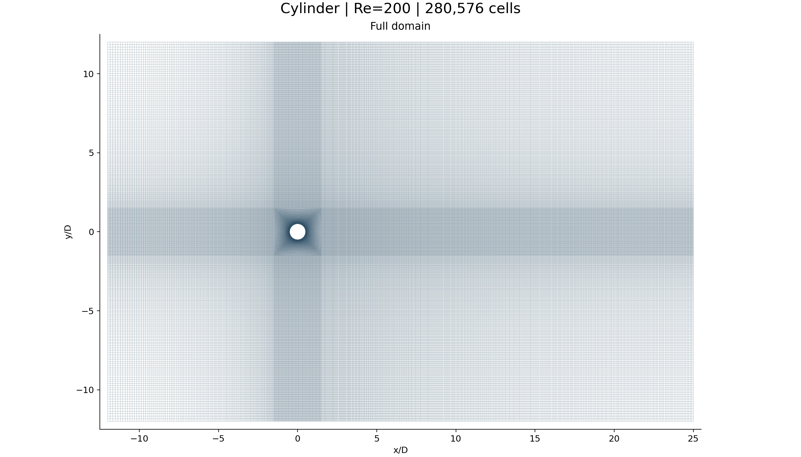
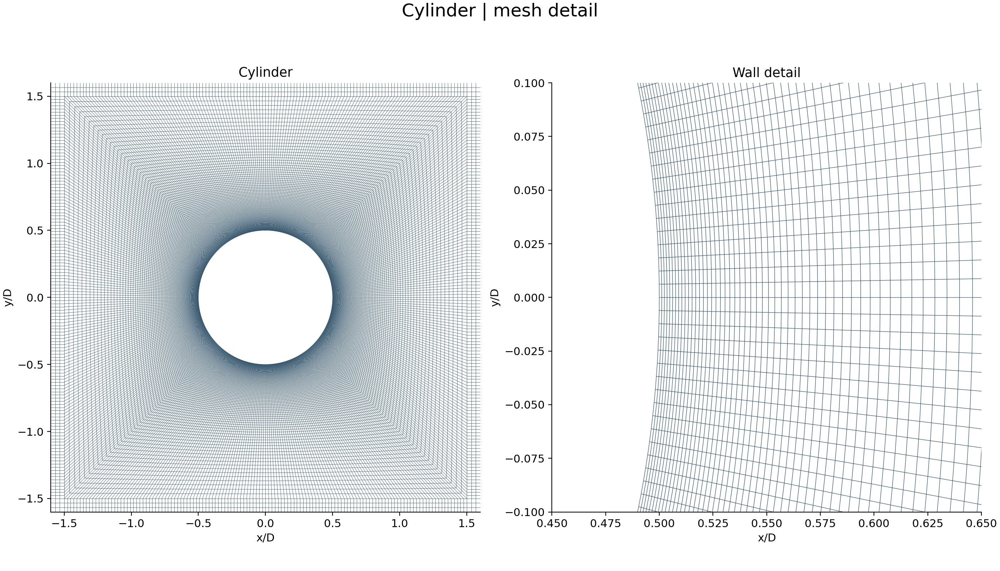
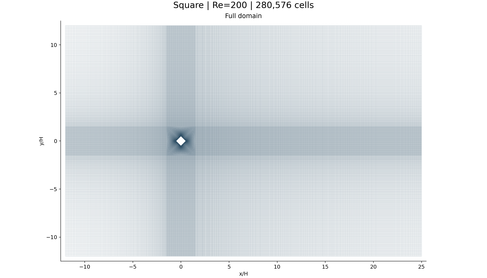
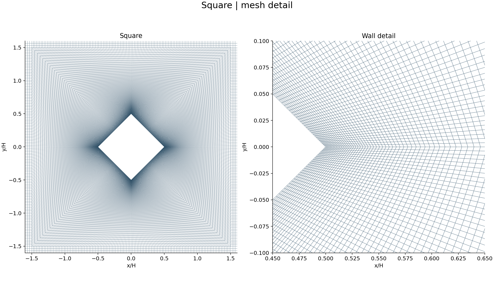
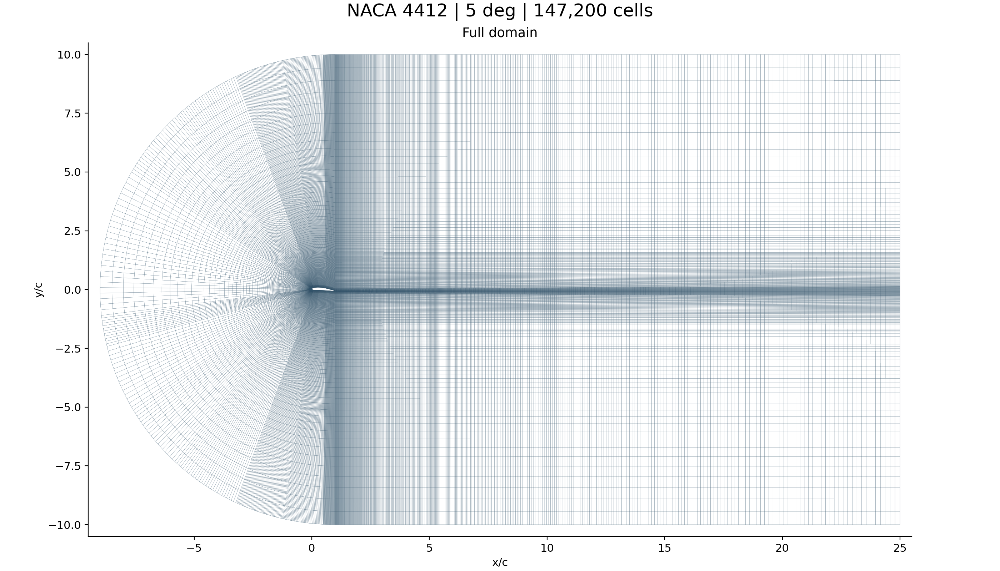
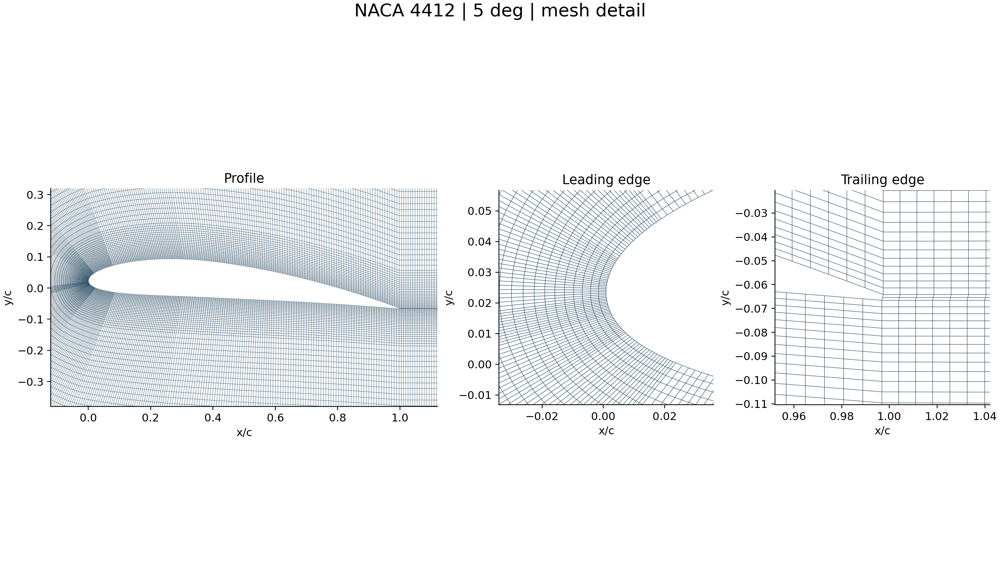

# OpenFOAM aerodynamics

Two-dimensional aerodynamic cases with OpenFOAM 14 and Python. Each case includes mesh generation, simulation and postprocessing.

## Cylinder

Laminar flow at $Re=U_\infty D/\nu=200$, with $D=1$, $U_\infty=1$ and $\nu=0.005$. The cylinder is fixed and no-slip; the inlet has fixed velocity, the outlet fixed pressure, and the upper and lower boundaries use freestream conditions. No imposed perturbation.

| Numerical method | Setting |
| --- | --- |
| Mesh | 280,576 quadrilateral cells; one cell across the empty span |
| Domain | $x/D\in[-12,25]$, $y/D\in[-12,12]$ |
| Time integration | Second-order backward |
| Convection | linearUpwind |
| Diffusion | Central differencing with non-orthogonal correction |
| Pressure-velocity coupling | PIMPLE: 2 outer iterations, 2 pressure correctors, 1 non-orthogonal corrector |
| Pressure solver | GAMG with DICGaussSeidel |
| Time step | Adaptive; maximum Courant number 0.5; maximum step 0.005 s |
| Duration / saved fields | 60 s / every 0.1 s |
| Parallel execution | 4 MPI processes |

<table>
<tr>
<td width="50%"></td>
<td width="50%"></td>
</tr>
</table>

Speed above, signed vorticity below. Both panels share physical time and passive particles; color scales remain fixed. The wake is still developing over this interval.


## Square

Laminar flow around a square rotated by 45 degrees, with a corner facing the inlet. The frontal width is $H=1$, the inlet speed $U_\infty=1$ and the kinematic viscosity $\nu=0.005$: $Re=U_\infty H/\nu=200$. The square is fixed and no-slip; the inlet has fixed velocity, the outlet fixed pressure, and the upper and lower boundaries use freestream conditions. No imposed perturbation.

| Numerical method | Setting |
| --- | --- |
| Mesh | 280,576 quadrilateral cells; 512 wall faces and 100 normal layers; one cell across the empty span |
| Domain | $x/H\in[-12,25]$, $y/H\in[-12,12]$ |
| Time integration | Second-order backward |
| Convection | linearUpwind |
| Diffusion | Central differencing with non-orthogonal correction |
| Pressure-velocity coupling | PIMPLE: 2 outer iterations, 2 pressure correctors, 1 non-orthogonal corrector (`consistent yes` after 49.6 s due to numerical instability) |
| Pressure solver | GAMG with DICGaussSeidel |
| Time step | Adaptive; maximum Courant number 0.5; maximum step 0.005 s |
| Duration / saved fields | 60 s / every 0.1 s |
| Parallel execution | 4 MPI processes |

<table>
<tr>
<td width="50%"></td>
<td width="50%"></td>
</tr>
</table>


## NACA 4412, 5 degrees

Laminar flow at $Re=U_\infty c/\nu=200$, with chord $c=1$, $U_\infty=1$ and $\nu=0.005$. The profile is rotated clockwise by 5 degrees about the quarter-chord point, giving a positive angle of attack with horizontal freestream. The airfoil is fixed and no-slip; the inlet has fixed velocity, the outlet fixed pressure, and the upper and lower boundaries use freestream conditions. No imposed perturbation.

| Numerical method | Setting |
| --- | --- |
| Mesh | 147,200 quadrilateral cells; conformal C-grid; one cell across the empty span |
| Domain | $x/c\in[-9,25]$, $y/c\in[-10,10]$ |
| Time integration | Second-order backward |
| Convection | linearUpwind |
| Diffusion | Central differencing with non-orthogonal correction |
| Pressure-velocity coupling | PIMPLE with `consistent yes`: 2 outer iterations, 2 pressure correctors, 1 non-orthogonal corrector |
| Pressure solver | GAMG with DICGaussSeidel |
| Time step | Adaptive; maximum Courant number 0.5; maximum step 0.005 s |
| Duration / saved fields | 60 s / every 0.1 s (configured) |
| Parallel execution | 4 MPI processes |

<table>
<tr>
<td width="50%"></td>
<td width="50%"></td>
</tr>
</table>

*Animation coming soon: synchronized speed above and vorticity below.*

## Run

In Ubuntu, from the project root:

```sh
python3 install_openfoam.py
source /opt/openfoam14/etc/bashrc
python3 cases/cylinder/run_cylinder.py
```

The simulation runs in the background. Follow it with:

```sh
tail -f cases/cylinder/log.run
```

After reconstruction:

```sh
python3 cases/cylinder/postprocess_cylinder.py --readme-gif --fps 20
python3 cases/cylinder/postprocess_cylinder.py --case cases/square --readme-gif --videos-only --fps 20
```
